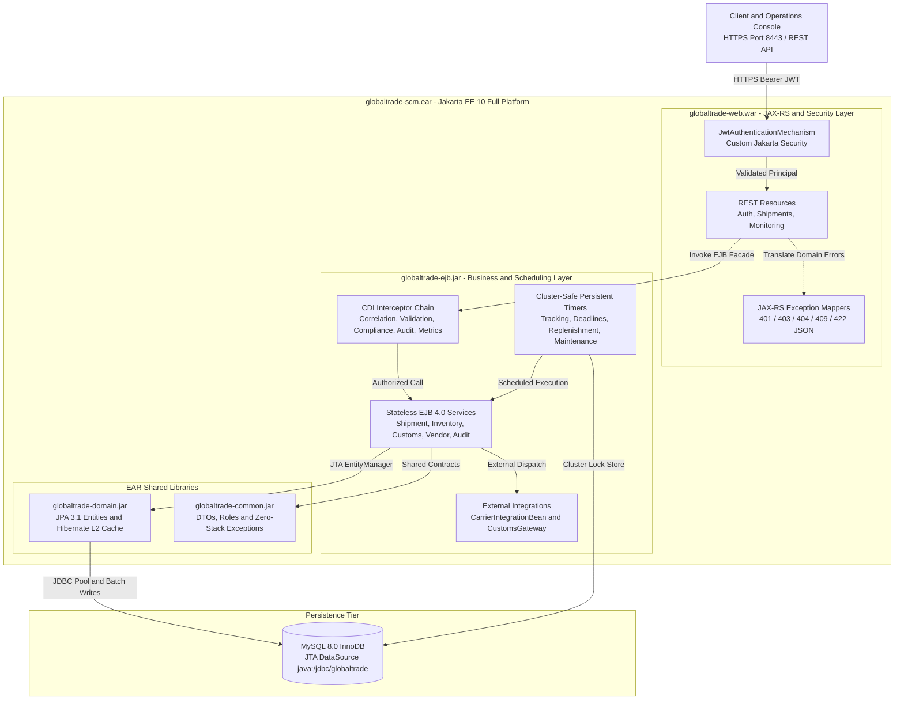
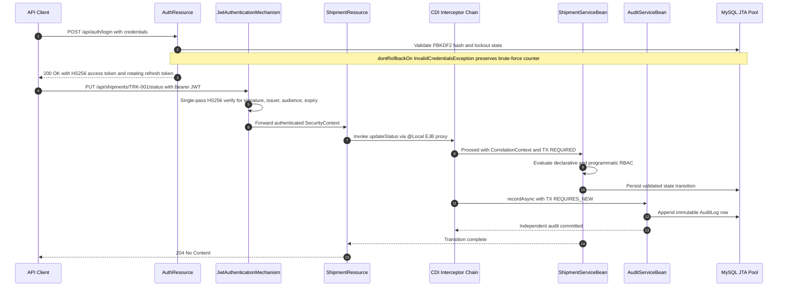
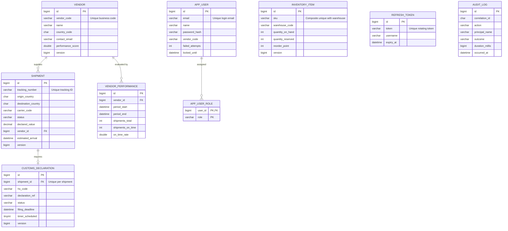

<div align="center">

# GlobalTrade SCM

**Enterprise Jakarta EE 10 Modular Supply Chain Management, Automated Customs Compliance & Real-Time Logistics Platform**

[](https://openjdk.org/)
[](https://jakarta.ee/)
[](https://www.wildfly.org/)
[](https://hibernate.org/)
[](https://www.mysql.com/)
[](LICENSE)

</div>

---

## Architectural Overview

**GlobalTrade SCM** is a production-oriented, multi-module Jakarta EE 10 Enterprise Archive (`EAR`) engineered for global logistics, automated customs compliance, warehouse inventory allocation, and vendor SLA tracking. Packaged across five cleanly isolated Maven modules (`common`, `domain`, `ejb`, `web`, and `ear`), the platform combines stateless EJB 4.0 transaction management, AOP CDI interceptors, clustered database-backed EJB timers, fail-fast HS256 JWT authentication with rotating refresh tokens, and an interactive TLS operations console.

### High-Level System Architecture



---

## Security & Transaction Flow

The platform implements defense-in-depth authorization combining declarative `@RolesAllowed` guards, programmatic data-ownership enforcement via `SessionContext`, and isolated audit logging via `REQUIRES_NEW` transactions so security/business events persist even when an outer business transaction rolls back.



---

## Database Schema (Entity-Relationship Model)

Backed by MySQL 8.0 InnoDB under `READ COMMITTED` isolation with optimistic concurrency control (`version` columns), covering indexes for timer polling, and database-level `CHECK` constraints preventing negative inventory.



---

## Enterprise Integration Patterns & SOLID Architecture

| Principle / Pattern | Concrete Classes & Artifacts | Architectural Implementation |
|---|---|---|
| **Single Responsibility (SRP)** | `ShipmentServiceBean`, `InventoryServiceBean`, `CustomsDeclarationServiceBean`, `VendorServiceBean`, `AuditServiceBean`, `JwtUtil`, `PasswordHasher`, `RefreshTokenService`, `UserAccountService` | Each EJB and CDI service owns one bounded subdomain (logistics state machine, pessimistic stock locking, BMT customs filing, vendor SLA scoring, async audit persistence, cryptographic token/hash lifecycle). |
| **Open/Closed Principle (OCP)** | `@Audited`, `@ComplianceChecked`, `@Monitored`, `CustomsGateway#callRemoteGateway`, JAX-RS `@Provider` mappers (`SupplyChainExceptionMapper`, `UnauthorizedAccessExceptionMapper`, `SecurityExceptionMapper`, `InvalidCredentialsExceptionMapper`, `GenericExceptionMapper`) | New regulatory rules, telemetry sinks, gateway adapters, or domain exception HTTP mappings plug in via CDI bindings, subclass extension, or `@Provider` registration without modifying existing business beans. |
| **Liskov Substitution & Interface Segregation (LSP / ISP)** | `@Local` contracts (`ShipmentService`, `InventoryService`, `CustomsDeclarationService`, `VendorService`, `AuditService`), `@Remote` (`CarrierIntegrationRemote`), `SupplyChainException` hierarchy | Fine-grained local interfaces eliminate serialization overhead for intra-EAR calls while isolating cross-JVM carrier traffic behind a narrow `@Remote` boundary; domain exceptions substitute cleanly across mappers. |
| **Dependency Inversion (CDI / EJB DI)** | `IdentityStoreHandler` -> `SupplyChainIdentityStore`, `@EJB` interface injection (`ShipmentService`, `InventoryService`, `AuditService`), `@PersistenceContext("GlobalTradePU")` | High-level REST resources, timers, and interceptors depend strictly on interfaces and container-managed abstractions; swapping WildFly for Payara requires only substituting `persistence.xml`. |
| **AOP Cross-Cutting Concerns** | `SecurityAuditInterceptor` -> `VendorDataValidationInterceptor` -> `ComplianceCheckInterceptor` -> `AuditLoggingInterceptor` -> `PerformanceMonitoringInterceptor`, `CorrelationContext`, `MetricsRegistry` | Deterministically ordered (`@Priority`) 5-stage CDI interceptor pipeline propagates correlation IDs, normalizes inbound vendor payloads, enforces WCO SAFE/embargo rules, writes `REQUIRES_NEW` async audit trails, and records lock-free CAS latency metrics. |
| **External Carrier & Customs Gateway Decoupling (EIP)** | `CarrierIntegrationBean`, `CarrierIntegrationRemote`, `CustomsGateway`, `CustomsDeclarationServiceBean` | `CarrierIntegrationBean` enforces `TransactionAttributeType.NEVER` so outbound carrier HTTP calls never pin DB connections; `CustomsGateway` wraps remote calls in a lock-free `@Singleton` Circuit Breaker with atomic CAS half-open recovery; `CustomsDeclarationServiceBean` uses BMT split transactions to release JTA connections across slow national gateway filings. |
| **Stateless JWT & Defense-in-Depth Security** | `JwtAuthenticationMechanism`, `JwtUtil`, `PasswordHasher`, `SupplyChainIdentityStore`, `AuthResource`, `web.xml` | Custom Jakarta Security `HttpAuthenticationMechanism` performs single-pass HS256 verification and calls `notifyContainerAboutLogin()` so caller identity flows into EJB `SessionContext` for declarative (`@RolesAllowed`) + programmatic vendor-ownership RBAC, reinforced by fail-fast `GT_JWT_SECRET`, PBKDF2-HMAC-SHA256 (210k iterations), rotating refresh tokens, and forced TLS (`CONFIDENTIAL`). |

---

## Core Engineering Highlights

- **Strict Multi-Module EAR Separation:** Decouples shared contracts (`globaltrade-common`), JPA entities (`globaltrade-domain`), transactional EJBs (`globaltrade-ejb`), and JAX-RS endpoints (`globaltrade-web`) into a clean `globaltrade-scm.ear` deployment with container-provided dependencies.
- **Enterprise Transaction Semantics (CMT):** Explicitly leverages five JTA transaction attributes (`REQUIRED`, `REQUIRES_NEW`, `SUPPORTS`, `MANDATORY`, `NOT_SUPPORTED`) alongside `@Transactional(dontRollbackOn = InvalidCredentialsException.class)` to prevent failed login rollbacks from clearing brute-force lockout counters.
- **Zero-Trust Jakarta Security & JWT Hardening:**
  - Fail-fast cryptographic bootstrap: `JwtUtil` refuses to initialize without a 32+ character `GT_JWT_SECRET` environment variable or `gt.jwt.secret` JVM property.
  - Per-user salted PBKDF2 password hashing, 5-minute HS256 access tokens (`iss`, `aud`, `jti`, `roles`), rotating refresh tokens, and forced HTTPS transport constraints on `/api/*`.
  - Hybrid RBAC: Declarative `@RolesAllowed` combined with programmatic resource-ownership verification in `SessionContext` (restricting `VENDOR_REP` principals exclusively to their own shipments).
- **AOP Cross-Cutting CDI Interceptors:** Modular interceptors (`AuditLoggingInterceptor`, `ComplianceCheckInterceptor`, `PerformanceMonitoringInterceptor`, `SecurityAuditInterceptor`, `VendorDataValidationInterceptor`) with request-scoped `CorrelationContext` propagation.
- **Cluster-Safe Persistent EJB Timers:** Automatic and programmatic timers (`ShipmentTrackingTimerBean`, `CustomsDeadlineTimerBean`, `InventoryReplenishmentTimerBean`, `SecurityMaintenanceTimerBean`) backed by a shared MySQL timer datastore to guarantee single-node execution across clusters.
- **High-Performance ORM & Exception Optimization:** Selective Hibernate second-level caching (`ENABLE_SELECTIVE`), JDBC batch writes (`batch_size=50` + `rewriteBatchedStatements=true`), and lightweight zero-stack-trace application exceptions benchmarked at **>140x faster** than standard exception allocation.

---

## TLS Operations & Security Console (`globaltrade-web`)

`globaltrade-web/src/main/webapp/index.html` ships a zero-dependency, self-contained HTML/CSS/JS Operations Console (light/dark theme parity, in-memory bearer token handling, XSS-safe DOM rendering) served over TLS at `https://localhost:8443/globaltrade/`:

- **Session & JWT Inspector:** Authenticates via `POST /api/auth/login`, displays active principal/roles and token TTL, enforces HTTPS scheme guidance matching `web.xml`'s `CONFIDENTIAL` constraint, and revokes sessions via `POST /api/auth/logout`.
- **EJB Timer Service Monitor:** Calls `GET /api/admin/monitoring/timers` to inspect persistent vs. in-memory automatic `@Schedule` timers alongside active programmatic `TimerService` counts.
- **Interceptor Telemetry Visualizer:** Queries `GET /api/admin/monitoring/metrics` to render mean/max latency bar charts and failure counts collected by `PerformanceMonitoringInterceptor` and `MetricsRegistry`.
- **Instrumented 3-Leg Operation Pipeline:** Exercises `GET /api/shipments/{trackingNumber}` -> `PUT /api/shipments/{trackingNumber}/status` -> `GET /api/admin/monitoring/metrics` end-to-end and contrasts browser round-trip timing against server-side business-method mean latency.
- **Live Security Probe Suite:** Fires real browser-side attacks against the deployed API to verify HTTP `401` (missing token, tampered HS256 signature, bad credentials), HTTP `403` (wrong role on `/admin/monitoring/metrics`, horizontal vendor privilege escalation on cross-vendor shipments), and HTTP `404` (SQL injection payload safely parameterized by JPA).

---

## REST API Surface

All endpoints are served under `https://localhost:8443/globaltrade/api` (TLS enforced via `web.xml`).

| Method | Endpoint | Access Roles | Description |
|---|---|---|---|
| `POST` | `/auth/login` | `PermitAll` | Authenticate user, return HS256 JWT & rotating refresh token |
| `POST` | `/auth/refresh` | `PermitAll` | Rotate refresh token and mint fresh access token |
| `POST` | `/auth/logout` | `PermitAll` | Revoke active refresh token |
| `POST` | `/shipments` | `ADMIN`, `LOGISTICS_COORDINATOR` | Create compliant shipment (`201 Created` + `Location`) |
| `GET` | `/shipments/{trackingNumber}` | All authenticated roles | Track shipment (enforces vendor ownership for `VENDOR_REP`) |
| `PUT` | `/shipments/{trackingNumber}/status` | `ADMIN`, `LOGISTICS_COORDINATOR`, `CARRIER_SYSTEM` | Idempotent state-machine status update (`204 No Content`) |
| `POST` | `/shipments/{trackingNumber}/allocations` | `ADMIN`, `WAREHOUSE_MANAGER`, `LOGISTICS_COORDINATOR` | Reserve warehouse SKU inventory & dispatch |
| `GET` | `/shipments/in-transit` | `ADMIN`, `LOGISTICS_COORDINATOR` | List active in-transit shipments |
| `GET` | `/shipments/overdue` | `ADMIN`, `LOGISTICS_COORDINATOR` | Query shipments past estimated arrival |
| `GET` | `/admin/monitoring/metrics` | `ADMIN`, `LOGISTICS_COORDINATOR` | Real-time EJB invocation counts, latencies & failure rates |
| `GET` | `/admin/monitoring/timers` | `ADMIN` | Inspect active automatic & programmatic EJB timers |
| `DELETE` | `/admin/monitoring/metrics` | `ADMIN` | Reset in-memory telemetry counters |

---

## Repository Structure

```text
globaltrade-scm/
├── pom.xml                                  # Parent Maven reactor & dependency BOM
├── LICENSE                                  # MIT License
├── .env.example                             # Environment variables template
├── database/
│   ├── 01-schema.sql                        # MySQL 8 InnoDB DDL, indexes & constraints
│   ├── 02-seed.sql                          # Salted PBKDF2 demo accounts & seed data
│   ├── 03-datasource-wildfly.sh             # Idempotent WildFly 31+ CLI provisioning
│   └── 03-datasource-payara.sh              # Alternate Payara 6 / GlassFish 7 setup
├── deployment/
│   └── DEPLOYMENT-GUIDE.md                  # Full production & local deployment manual
├── run/
│   ├── 0-check-environment.sh               # Pre-flight JDK / Maven / MySQL / WildFly check
│   ├── 1-start-wildfly.sh                   # Boot WildFly standalone-full.xml
│   ├── 2-configure-wildfly.sh               # Apply datasource, timers, JASPI & JWT key
│   ├── 3-deploy.sh                          # Build EAR & deploy via jboss-cli
│   ├── 4-tail-log.sh                        # Stream live WildFly server logs
│   ├── 5-open-console.sh                    # Open HTTPS Operations Console
│   ├── DIAGNOSE-403.sh                      # JWT claim & RBAC diagnostic probe
│   └── RESET-AND-DEPLOY.sh                  # Clean undeploy, rebuild & redeploy
├── globaltrade-common/                      # Constants, DTOs, exceptions, bindings
├── globaltrade-domain/                      # JPA 3.1 entities & persistence.xml
├── globaltrade-ejb/                         # Stateless EJBs, interceptors, timers & JUnit 5 tests
├── globaltrade-web/                         # JAX-RS API, JWT security & operations UI
└── globaltrade-ear/                         # Deployable Jakarta EE EAR packaging
```

---

## Getting Started

### Prerequisites

- **JDK 17+** (tested on JDK 17 & JDK 21)
- **Apache Maven 3.9+**
- **MySQL Server 8.0+**
- **WildFly 31.0+ (Full Platform)** — or Payara 6 (see [DEPLOYMENT-GUIDE.md](deployment/DEPLOYMENT-GUIDE.md))

### 1. Clone & Configure Environment

```bash
git clone https://github.com/theekshana-sudeepa/globaltrade-scm.git
cd globaltrade-scm
cp .env.example .env
```

Update `.env` (or export variables in your shell) with your WildFly path, MySQL credentials, and a 32+ character `GT_JWT_SECRET`.

### 2. Initialize MySQL Database

```bash
mysql -u root -p < database/01-schema.sql

mysql -u root -p -e "
  CREATE USER IF NOT EXISTS 'globaltrade'@'localhost' IDENTIFIED BY 'CHANGE_ME_TO_A_SECURE_PASSWORD';
  GRANT SELECT, INSERT, UPDATE, DELETE ON globaltrade.* TO 'globaltrade'@'localhost';
  FLUSH PRIVILEGES;"

mysql -u root -p < database/02-seed.sql
```

### 3. Build & Run Unit / Performance Benchmarks

```bash
mvn clean package
```

This compiles all five modules, executes the 28 JUnit 5 tests (transaction attribute semantics, shipment state machine, customs gateway circuit breaker, interceptor overhead, and exception benchmarks), and outputs `globaltrade-ear/target/globaltrade-scm.ear`.

### 4. Provision & Deploy to WildFly

```bash
export WILDFLY_HOME=~/wildfly-31.0.1.Final
export DB_PASS="CHANGE_ME_TO_A_SECURE_PASSWORD"

# Terminal 1: Start WildFly Full Profile
./run/1-start-wildfly.sh

# Terminal 2: Configure JTA datasource, persistent timers, JASPI fix & JWT secret
./run/2-configure-wildfly.sh

# Deploy EAR
./run/3-deploy.sh
```

Once deployed, open the interactive Operations & Security Console at:
**`https://localhost:8443/globaltrade/`**

> **Demo Seed Accounts** (from `database/02-seed.sql`, default password `Passw0rd!2026`):
> - Administrator: `admin@globaltrade.lk`
> - Vendor Representative: `rep@acme-supplies.com`

---

## License

This project is licensed under the **MIT License** — see the [LICENSE](LICENSE) file for details.

---

<div align="center">

**Engineered by Theekshana Sudeepa**

[](https://www.linkedin.com/in/theekshana-sudeepa/)
[](https://github.com/theekshana-sudeepa)
[](https://lexoratech.com)

</div>
